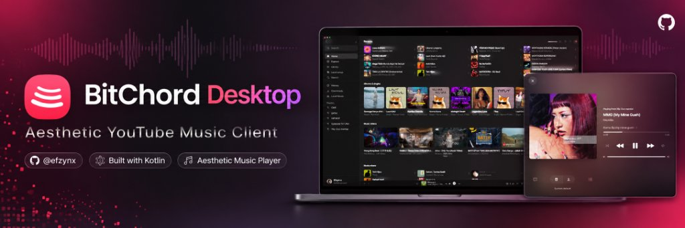
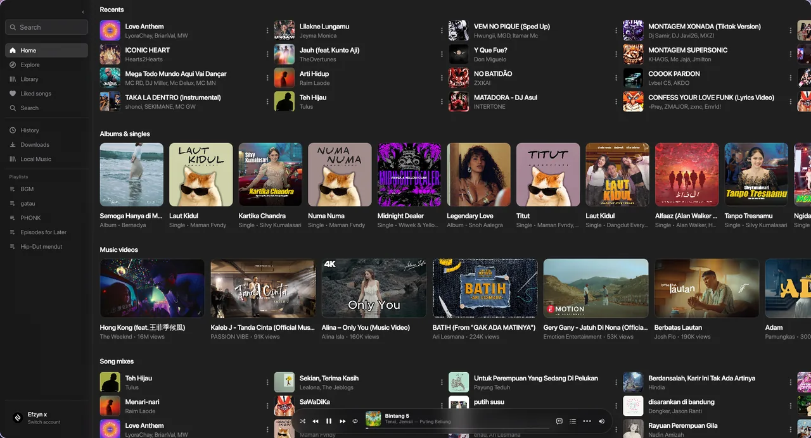
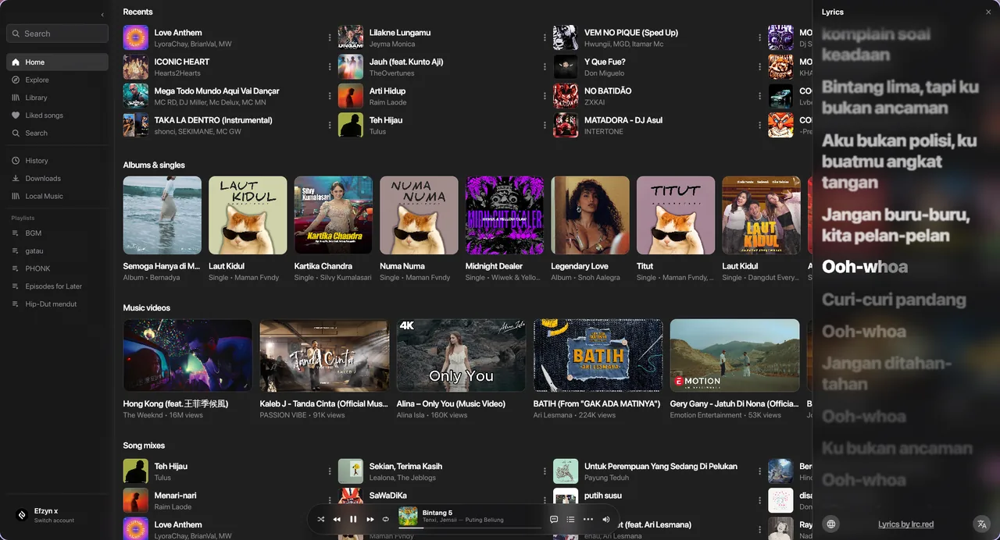
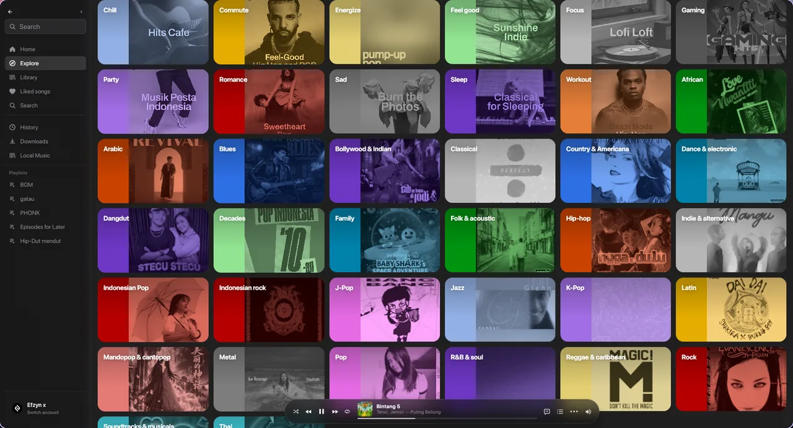
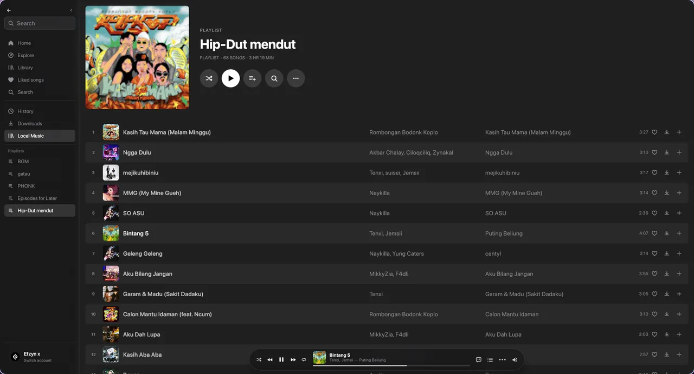
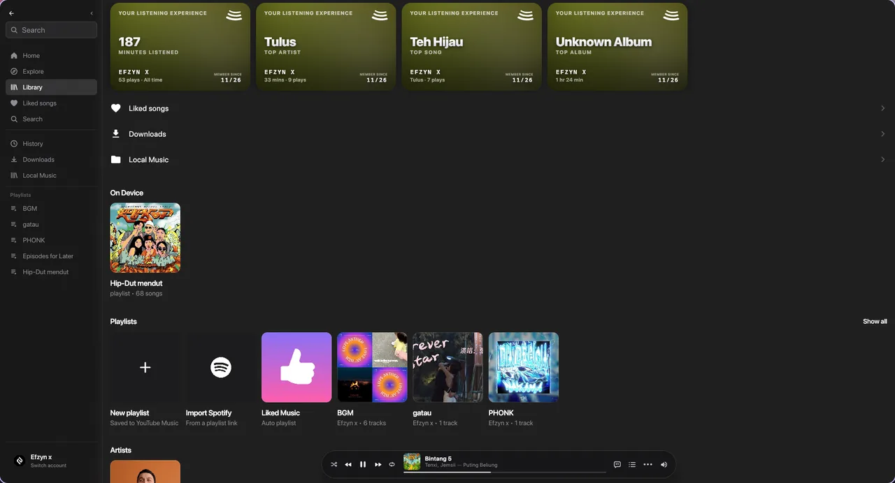
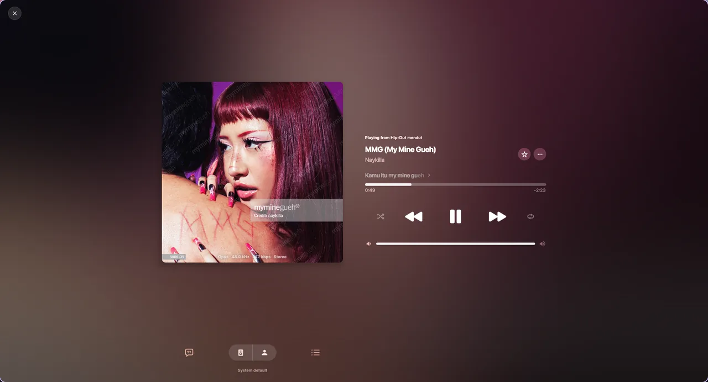

<div align="center">



<br/><br/>

<picture>
  <source media="(prefers-color-scheme: dark)" srcset="https://raw.githubusercontent.com/efzynx/BitChord-Desktop/assets/Logo.png">
  <source media="(prefers-color-scheme: light)" srcset="https://raw.githubusercontent.com/efzynx/BitChord-Desktop/assets/Logo-Light.png">
  
</picture>

### Aesthetic, High-Performance YouTube Music Client for Linux & Windows

<p align="center">
  <a href="https://github.com/efzynx/BitChord-Desktop/releases"></a>
  &nbsp;
  <a href="#download"></a>
  &nbsp;
  <a href="https://www.jetbrains.com/lp/compose-multiplatform/"></a>
  &nbsp;
  <a href="#desktop-architecture--native-integrations"></a>
  &nbsp;
  <a href="https://github.com/efzynx/BitChord-Desktop/releases"></a>
  &nbsp;
  <a href="LICENSE"></a>
</p>

<br/>

[**Download**](#download) &bull; [**Screenshots**](#screenshots) &bull; [**Key Features**](#key-features) &bull; [**Listen Together**](#listen-together-party-mode) &bull; [**Native Integrations**](#desktop-architecture--native-integrations) &bull; [**Shortcuts**](#keyboard-shortcuts) &bull; [**Desktop Guide**](DESKTOP.md) &bull; [**Contributing**](#contributing)

</div>

> [!IMPORTANT]
> BitChord Desktop is an independent open-source audio client and is not affiliated with, endorsed by, or connected to YouTube, Google, or any of their parent companies.

---

## About This Project

BitChord Desktop is an independent, community-driven desktop port of BitChord by Kushagra Singh.

Originally initiated by [Kushagra Singh](https://github.com/kushagrasinghx) as an Android application (BitChord), earlier desktop prototypes were discontinued in the upstream repository.

**This project ([efzynx/BitChord-Desktop](https://github.com/efzynx/BitChord-Desktop)) is an active, dedicated continuation that reconstructs, modernizes, and maintains high-performance native desktop clients for Linux and Windows.**

Built on **Compose Multiplatform (Jetpack Compose on Desktop JVM)** and an integrated **C++ / JavaCPP FFmpeg 7.1 audio pipeline**, BitChord Desktop delivers a refined frosted-glass interface, ultra low-latency playback, native OS media integrations, word-by-word synced lyrics, and real-time Listen Together room synchronization.

The architectural reconstruction, desktop porting, C++/FFmpeg optimizations, bug fixes, and feature expansions in this repository are actively developed and maintained by [@efzynx](https://github.com/efzynx) with full engineering assistance from **Google DeepMind Gemini** (via the Antigravity agent system).

---

## Screenshots

<details open>
<summary><b>Click to expand / collapse application screenshots</b></summary>
<br/>

<table width="100%">
  <tr>
    <td width="50%" align="center"><b>Home & Player Bar</b><br/><br/></td>
    <td width="50%" align="center"><b>Synced Lyrics (Apple Music Style)</b><br/><br/></td>
  </tr>
  <tr>
    <td width="50%" align="center"><b>Explore & Recommendations</b><br/><br/></td>
    <td width="50%" align="center"><b>Playlist & Collection View</b><br/><br/></td>
  </tr>
  <tr>
    <td width="50%" align="center"><b>Local Music Library</b><br/><br/></td>
    <td width="50%" align="center"><b>Maximized Player & Backdrop</b><br/><br/></td>
  </tr>
</table>

</details>

---

## Key Features

<table>
  <tr>
    <td width="50%" valign="top">

### Aesthetic Interface & Experience
- **Apple Music-Style Aesthetic Player**: Liquid blur and frosted-glass chrome with an interactive blurred progress scrub on hover.
- **Dynamic Color Palette**: Real-time Material color extraction directly from album artwork.
- **Smart Overflow Marquee**: Auto-scrolling horizontal marquee for song titles, artist credits, and albums when the window is compact.
- **Multi-Artist & Album Navigation**: Clickable multi-artist credits and direct album jump buttons from the player bar.
- **Synchronized Syllable Lyrics**: Frame-rate accurate word-by-word animated lyrics (powered by LRCLIB, Musixmatch, YouTube Captions, KuGou, and local embedded tags).
- **Animated Album Canvas**: Spotify Canvas and visual motion artwork support.
- **Responsive Layout**: Seamless transition between wide-screen desktop mode and compact floating navigation.

### Social & Collaborative Listening
<a id="listen-together-party-mode"></a>
- **Listen Together (Party Mode)**: Real-time room synchronization to listen with friends simultaneously.
- **Cloudflare Quick Tunnel**: One-click public tunneling via `trycloudflare.com` to host party rooms without opening router ports or configuring static IPs.
- **Multi-Language Support**: Fully dynamic localization system supporting English and Indonesian.

    </td>
    <td width="50%" valign="top">

### High-Fidelity Audio Engine
- **Native FFmpeg 7.1 Pipeline**: JavaCPP hardware-accelerated audio decoding supporting Lossless Hi-Res (FLAC, ALAC, WAV) and standard web formats (Opus, AAC, MP3, WebM).
- **Windowed Range Streaming**: Eliminates Google Video HTTP 403 Forbidden throttling using chunked byte-range requests.
- **Headless PoToken Minter**: Built-in headless WebKit WebEngine to process Google BotGuard scripts and mint integrity tokens without user intervention.
- **Bit-Perfect DAC Output**: Exclusive USB DAC audio stream passthrough.
- **Gapless & Crossfade**: Smooth 0–12 second transitions between tracks.
- **DJ Automix Transition**: Dynamic beat and tempo-matched song transitions.

### System & Connectivity
- **Native Discord RPC**: Local IPC via Unix Domain Sockets (Linux) and Named Pipes (Windows)—no bot tokens or account logins required.
- **Audio Scrobbling**: Built-in Last.fm and ListenBrainz tracking.
- **Local Library & File Watching**: Real-time directory monitoring (`~/Music`, `~/Downloads`) via Java NIO `WatchService`.
- **In-App Updater & Diagnostics**: System information dashboard detecting OS, CPU architecture, Java runtime, and package format with GitHub release check.

    </td>
  </tr>
</table>

---

## Desktop Architecture & Native Integrations

### Linux Platform Integration
- **MPRIS D-Bus Specification**: Native integration with `org.mpris.MediaPlayer2` and `org.mpris.MediaPlayer2.Player`. Fully compatible with GNOME Media, KDE Plasma Media Player, `playerctl`, and lock screens.
- **Hardware Multimedia Keys**: Global media key listeners for Play, Pause, Next, Previous, and Stop.
- **FreeDesktop Standards**: Compliant `.desktop` launcher with context menu actions (Play/Pause, Next, Previous) and high-resolution vector icons.
- **Production Packaging**: Universal **AppImage**, Debian/Ubuntu **DEB**, Fedora/RHEL **RPM**, and standalone portable tarballs.
- **One-Command User Installer**: Automated script via `scripts/install-desktop.sh` registering icons and launchers to `~/.local`.

### Windows Platform Integration
- **System Media Transport Controls (SMTC)**: Native Windows media transport controls displayed in the volume overlay, taskbar thumbnail, and lock screen.
- **Native Installers**: Automated builds for Windows Installer (**MSI**) and setup executable (**EXE**).
- **Portable Distribution**: Clean portable `.zip` featuring a silent runner (`BitChord.vbs`) that executes the player in the background without terminal prompts.

### Discord Rich Presence (RPC)
- Direct local Inter-Process Communication (IPC) via **Unix Domain Sockets** on Linux and **Named Pipes** on Windows.
- Eliminates third-party bots, account tokens, or login credentials. Automatically publishes playing status, album art, elapsed time, and metadata.

---

## Download

Prebuilt binary releases are available for direct download below, on the [**Official Web Portal**](https://efzynx.github.io/BitChord-Desktop/), and through the [**GitHub Releases**](https://github.com/efzynx/BitChord-Desktop/releases) page.

| Platform | Package Format | Direct Download (Latest Stable) | Description |
| :--- | :--- | :--- | :--- |
| **Linux** | **AppImage** | [**Download .AppImage**](https://github.com/efzynx/BitChord-Desktop/releases/download/v1.9.2/BitChord-1.9.2-x86_64.AppImage) | **Recommended**. Universal standalone executable for all modern Linux distributions. |
| **Linux** | **DEB** | [**Download .deb**](https://github.com/efzynx/BitChord-Desktop/releases/download/v1.9.2/bitchord_1.9.2_amd64.deb) | Native package for Debian, Ubuntu, Linux Mint, and derivatives. |
| **Linux** | **RPM** | [**Download .rpm**](https://github.com/efzynx/BitChord-Desktop/releases/download/v1.9.2/bitchord-1.9.2.x86_64.rpm) | Native package for Fedora, RHEL, openSUSE, and derivatives. |
| **Linux** | **Tar.gz** | [**Download .tar.gz**](https://github.com/efzynx/BitChord-Desktop/releases/download/v1.9.2/BitChord-1.9.2-linux-x64.tar.gz) | Portable tarball with automated `install-desktop.sh` launcher script. |
| **Windows** | **Setup EXE** | [**Download .exe**](https://github.com/efzynx/BitChord-Desktop/releases/download/v1.9.2/BitChord-1.9.2.exe) | **Recommended**. Windows Setup installer with Start Menu and Desktop shortcuts. |
| **Windows** | **MSI** | [**Download .msi**](https://github.com/efzynx/BitChord-Desktop/releases/download/v1.9.2/BitChord-1.9.2.msi) | Standard Windows Installer package for system-wide deployment. |
| **Windows** | **ZIP (Portable)** | [**Download .zip**](https://github.com/efzynx/BitChord-Desktop/releases/download/v1.9.2/BitChord-1.9.2-windows-portable.zip) | Standalone portable archive with silent background runner (`BitChord.vbs`). |

> [!TIP]
> Visit the [**BitChord Web Portal**](https://efzynx.github.io/BitChord-Desktop/) for automatic OS detection and one-click downloads. For detailed installation instructions, distro-specific guides, and uninstallation steps, refer to the [**DESKTOP.md**](DESKTOP.md) guide.

---

## Keyboard Shortcuts

| Shortcut | Action |
| :--- | :--- |
| **`Space`** | Play / Pause |
| **`Media Play/Pause`** | Hardware multimedia toggle |
| **`Media Next / Prev`** | Next track / Previous track |
| **`Left Arrow` (`<-`)** | Seek backward 5 seconds |
| **`Right Arrow` (`->`)** | Seek forward 5 seconds |
| **`Up Arrow` (`^`)** | Volume up (+5%) |
| **`Down Arrow` (`v`)** | Volume down (-5%) |
| **`M`** | Mute / Unmute |
| **`Ctrl + F` / `Cmd + F`** | Focus search input field |
| **`Ctrl + ,` / `Cmd + ,`** | Open Settings & System Info dashboard |
| **`F11` / `F`** | Toggle Fullscreen mode |
| **`Esc`** | Dismiss Now Playing / Dialogs / Return to previous view |

---

## Building from Source

### Prerequisites
- **JDK 17** or higher
- Git

### Build & Run
```bash
# Clone the repository
git clone https://github.com/efzynx/BitChord-Desktop.git
cd BitChord-Desktop

# Run the desktop application locally
./gradlew :desktopApp:run

# Package a universal Linux AppImage
./gradlew :desktopApp:packageAppImage

# Package a Windows portable distribution (on Windows)
gradlew.bat :desktopApp:windowsPortable -Pbitchord.target=windows
```

---

## Contributing

Contributions are warmly welcomed! Please read our [Contributing Guide](CONTRIBUTING.md) and [Code of Conduct](CODE_OF_CONDUCT.md) prior to submitting pull requests.

[**Contributing Guide**](CONTRIBUTING.md) &bull; [**Code of Conduct**](CODE_OF_CONDUCT.md) &bull; [**Maintainers**](MAINTAINERS.md) &bull; [**Desktop Docs**](DESKTOP.md) &bull; [**Additional Docs**](ADDITIONAL.md)

### Credits & Acknowledgements
- **Original BitChord Author**: [Kushagra Singh](https://github.com/kushagrasinghx) ([kushagrasinghx/BitChord](https://github.com/kushagrasinghx/BitChord))
- **Desktop Port & Maintenance**: [efzynx](https://github.com/efzynx) ([efzynx/BitChord-Desktop](https://github.com/efzynx/BitChord-Desktop))
- **AI Engineering Partner**: [Google DeepMind Gemini](https://deepmind.google/technologies/gemini/) (via Google Antigravity Agent System)
- **Apple Music Lyrics Engine**: [binimum](https://github.com/binimum/am-lyrics)
- **Bit-Perfect DAC Passthrough**: [Mornye](https://github.com/mornyeapp/Mornye)
- Community contributors across upstream and desktop repositories.

---

## Support

BitChord Desktop is free and open-source software. If you enjoy using BitChord Desktop and want to support its ongoing development and maintenance:

<p align="center">
  <a href="https://ko-fi.com/efzynx" target="_blank" rel="noopener noreferrer"></a>
  &nbsp;&nbsp;
  <a href="https://trakteer.id/efzyn/gift" target="_blank" rel="noopener noreferrer"></a>
  &nbsp;&nbsp;
  <a href="https://saweria.co/efzynx" target="_blank" rel="noopener noreferrer"></a>
</p>

---

## Disclaimer & Legal Notice

BitChord Desktop is an independent, community-driven desktop port of BitChord by Kushagra Singh. It is not affiliated with, endorsed by, or associated with Google LLC, YouTube, Deezer, or Telegram.

- **No Media Hosting**: BitChord Desktop does not host, upload, or store copyrighted audio content. It functions as an interface to index local storage or stream via public-facing APIs.
- **Fair Use**: This project is developed for educational and personal research purposes. Users are responsible for ensuring compliance with applicable regional laws and third-party terms of service.
- **License**: Distributed under the **GNU General Public License v3.0 (GPLv3)**. See [LICENSE](LICENSE) for details.

---

<div align="center">

&copy; 2026 BitChord Desktop Contributors. Licensed under GPL-3.0.

</div>
